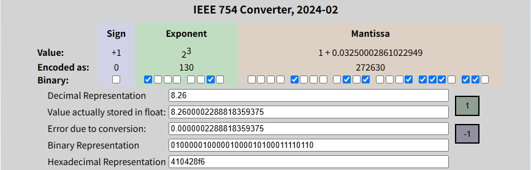

# Ⅰ.引入
Python，C，都能得到一个反直觉的结果，0.1 + 0.2 == 0.3 返回的是 false。本文将从 0.1 + 0.2 展开，解释为什么浮点数的计算存在误差，并提供一种简单的估计误差的方法，期望在编码时，这个方法能帮我们提前考虑到计算误差的风险，并在设计时尽量规避这样的风险。

```c
#include <stdio.h>
int main(void)
{

    printf("0.1 + 0.2 == 0.3 : %s\n", 0.1 + 0.2 == 0.3 ? "True" : "False");
    printf("0.3 - 0.1 - 0.2 : %.2e\n", 0.3 - 0.1 - 0.2);
    return 0;
}
```


> 精度问题无法解决的原因

浮点数表示这里有一个无法解决的问题，数学中任意小段连续的数轴中的小数就是无限的，这意味着我们需要无限个互不相同的零一序列（一对一的映射）才能表示。但是，现实的计算机中，我们没有无限的内存，有限的内存就意味着我们只能表示有限的数字。简单而言，从数学角度说，无论任何浮点数标准，都面临用有限的集合去映射无限的集合的问题，都一定会存在精度问题。

# Ⅱ.浮点数误差产生原因

## 1.编码引入的误差
与整数不同，因为浮点数在计算机中的存储方式（IEEE754），浮点数无法精确表示有效范围内的所有数值。
而有效范围内的数值是否可以被精确表示，取决于有效数字fraction是否可以被完全存储。
只有**分母只含因子2的分数才能有限位地写成二进制**，
所以 3.5（=7/2）可以精确存储，3.6（=18/5）不行。


+ 最高位一位是符号位sign，用于区分正负（0正1负）
+ 中间exponent（8位）代表指数部分 
+ 低位fraction/尾数存储有效数字。
 
==> 以十进制的 $8.26 \times 10^2$ 为例，可以形象地理解fraction（.26）决定了数字是哪个数字，exponent（2）决定了小数点在哪。

### 十进制8.26转二进制示例
（此小节简单了解即可）


整数部分+小数部分得到二进制结果为1000.01000010100011110101 11000…

根据IEEE754标准，即符号位+尾数+阶码的计数方式，可以表示为$ 1.0000100001 × 2 ^3 $。三个字段这样确定：

+ **符号位**：正数，记为 0
+ **阶码部分**：字段里存的**不是真实指数3，而是加过偏移量的阶码**。真实指数 $e=3$，float的偏移量是127，所以存$e + 127 = 3 + 127 = 130$，二进制 `10000010`。（这里的编码方式叫**移码** / excess-bias，double的偏移量是1023）
+ **尾数部分**：规格化后小数点前那个1是**隐含的**（不占存储位，只为白赚1位精度），字段里只存小数点后的部分 `0.0000100001…`。取 23 位：截断是 `00001000010100011110101`，后面剩的位是 `11000…`，超过一半（守卫位为 1 且粘滞位非零），四舍五入进一位，得到 `00001000010100011110110`。

+ `规格化` 决定小数点前只留一个1（顺便把这个 1 藏起来不存）。如1000 . 0100001010001111010111 --规格化--> 1 . 0000100001010001111010111…
+ `加127`  只是把负指数的问题转成无符号表示。两者合用才是 IEEE754 的编码方式。

| 名称                 | 含义                     | 本例                  |
| -------------------- | ------------------------ | --------------------- |
| 守卫位 guard / round | 丢掉的位里的第 1 位      | 1                     |
| 粘滞位 sticky        | 后面所有位是否有一个非 0 | 1（因为还有 100010…） |
+ 守卫位 = 0  → 不进位
+ 守卫位 = 1、粘滞位 = 0 → 向偶数舍入
+ 守卫位 = 1、粘滞位 = 1 → 进位

最终结果为（以二进制表示）

> 0 - 10000010 - 00001000010100011110110（0x410428F6）


> 这个例子只是为了说明，在定义float a = 8.26f;的时候已经引入了误差

## 2.运算时的累积的误差

IEEE754 只规定了"每一次运算的结果必须按当前舍入模式舍入到最接近的可表示值"，并没有规定多次运算该怎么组合。于是每次运算都会引入最多**0.5 ulp**（unit in the last place，是最低位一个单位）的误差，误差再随运算链路一层层累积——这是误差随计算规模放大的根本原因。

举个最直观的例子：float 的有效位只有 24 位，当两个数相差太大时，小数会直接被"吃掉"。

```c
float big = 16777216.0f;            // 2^24，从这里开始 ulp = 2
printf("%.1f\n", big + 1.0f);       // 16777216.0 —— 加 1 完全没反应
printf("%.1f\n", big + 2.0f);       // 16777218.0 —— 加 2 才动一位
```

误差累积的例子：把 0.1f 累加 10 次，期望是 1.0，实际是 1.0000001192092896（即 1 + 2⁻²³）。每次加法最多引入半个 ulp 的误差，10 次加下来最后偏了整整一个 ulp——这就是"误差随运算次数累积"的直接体现。

```c
float s = 0.0f;
for (int i = 0; i < 10; i++) s += 0.1f;
printf("%.17g\n", (double)s);       // 1.0000001192092896
printf("%d\n", s == 1.0f);          // 0（false）
```


float 能表示约 $[1.4\times10^{-45},\ 3.4\times10^{38}]$（含正负两个半轴，1.175e-38 是*规格化数*的下限，再往下是非规格化数）。超出范围叫溢出，IEEE754 默认模式下溢出**不会抛异常**，而是直接返回 ±inf（下溢返回 ±0）。

## 3.平台不同实现引入的误差
 不同平台处理浮点的算法不一致，会导致运算结果不一致。存在这几个方面：

+ 编码规则，这个IEEE一般都是有颁布运算标准的，这个部分基本是已经标准化了
+ 舍入方式：其实是规则的一部分，但是IEEE自己也保留了好几套舍入方式
+ 硬件：具体的就是，浮点寄存器的位宽。比如 Intel x87 FPU 提供 80 位扩展精度，那么用了这个扩展和不用，就会导致精度的不同。
+ 平台对float设置和优化不同：如微软的/fp指令.(https://docs.microsoft.com/en-us/cpp/build/reference/fp-specify-floating-point-behavior?view=msvc-170)

## 4.类型转换引入的误差
这里有两个**互相独立**的维度，不要混为一谈：

- **隐式 / 显式**：是否写下强制转换的语法，只是写法问题。
- **无损 / 有损**：转换后能否还原出原值，这才是产生误差的原因。

典型的无损转换是"从窄整数到能完整覆盖它的宽整数"，比如 `int` → `int64_t`；

有损转换发生在"宽到窄"或"整数与浮点互转"时，而且它既可能隐式发生，也可能显式发生：

```c
int a = (int)10.9f;                 // 显式、有损：结果是 10，小数被截断
long long b = 9007199254740993LL;   // 隐式、有损：把这个值读进 double 时存不下（它大于 2^53）
```


# Ⅲ.浮点数误差的应对

## 1.有效位数：6~7 位是怎么来的
单精度浮点数（float）总共用32位来表示浮点数，其中尾数用23位存储，加上小数点前有一位隐藏的1（IEEE754规约数表示法），
$ 2^{23+1} = 16777216 $。因为$ 10^7 \lt 16777216 \lt 10^8 $，
所以说单精度浮点数的有效位数是7位。
考虑到第7位可能的四舍五入问题，所以单精度最少有6位有效数字（最小尺寸）。

> 通常认为单精度浮点数的有效数字是6~7位，绝对可以保证的是6位。

```c
float f = 3.123456f;
printf("%f\n", f);      // 3.123456
printf("%.10f\n", f);   // 3.1234560013 —— 存进去的是 3.1234560012817383
```

注意：第一行用 `%f` 打印**看不出任何问题**，必须加宽到 `%.10f` 才能看到尾巴上的误差。这就是"6~7 位有效数字"的准确含义——误差出现在第 7 位有效数字之后。

更能说明问题的是"整数部分已经吃满有效位"的情况：

```c
float f = 1234560.991f;
printf("%f\n", f);      // 1234561.000000 —— 小数部分完全丢失
printf("%.10f\n", f);   // 1234561.0000000000，一点小数都没剩下
```

紧接着要回答的问题是：**"保留两位小数"这个要求，在多大量级的数上还能兑现？** 先把这条边界算出来（见下表），再回头看超出边界时会发生什么。

### 举例：保留两位小数时整数上限是 131071

以想要保留**小数点后两位**为例，那么单精度浮点数整数部分可以使用的最大值是多少？
要保证小数点后两位小数有效，即需要保证的精确度为0.01。
frac共23位，
+ 第一位代表$ 2^{-1}=0.5 $
+ 第二位代表$ 2^{-2}=0.25 $ 
+ 依次类推...
+ 第六位代表$ 2^{-6}=0.015625 $
+ 第七位代表$ 2^{-7}=0.0078125 $

**即至少需要7位小数域才能精确表示0.01。**

规格化浮点数有效数字域共23位，加上默认占有的1位，共24位表示有效数字。
小数部分需要占有7位有效数字域，那么整数部分占有位数为$ 24-7=17 $位。
$ 2^{17}=131072 $。注意 17 位能表示的**最大**整数是 $ 2^{17}-1=131071 $，所以保留小数点后两位时，单精度浮点数整数部分最大取131071；
再大就跨进下一个二进制阶，ulp 变成 2⁻⁶=0.015625 > 0.01，两位小数便不再可靠。

用同样的方法，下表中每一列的**整数最大值 = 2^(24−所需小数位数) − 1**：

| 精度       | 0.1     | **0.01**   | 0.001 | 0.0001 | 0.00001 | 0.000001 | 0.0000001 |
| ---------- | ------- | ---------- | ----- | ------ | ------- | -------- | --------- |
| 所需小数位 | 4       | **7**      | 10    | 14     | 17      | 20       | 24        |
| 整数最大值 | 1048575 | **131071** | 16383 | 1023   | 127     | 15       | 0         |

> 0.0000001 这一列需要 24 位小数，已经占满全部有效位，整数部分只能是 0。

### 超出表里边界会怎样：实测反例
```c
/*
 * 验证 Ⅲ.1 的精度表：要求小数点后 d 位时，float 的整数部分最多到多少？
 *
 * 每列给一对值，都必须先存进 float 再打印：
 *   边界内 maxI + frac   ->  %.d f 打印正确
 *   越界  (maxI+1) + frac ->  %.d f 打印错误
 *
 * 原因：越界后进入下一个二进制阶，ulp 翻倍。一旦 ulp > 10^-d，
 *       第 d 位小数就不再可靠。
 */
#include <stdio.h>

#define F(x) ((double)(float)(x))   /* 强制先存成 float，再传给 printf */

int main(void)
{
    puts("列  要求精度    整数上限    边界内 -> 印出     越界 -> 印出      真值应为");
    puts("----------------------------------------------------------------------------------");

    printf("1   %-11s %-10d %-17.1f %-16.1f %.1f\n",
           "0.1", 1048575, F(1048575.1651f), F(1048576.1651f), 1048576.1651);

    printf("2   %-11s %-10d %-17.2f %-16.2f %.2f\n",
           "0.01", 131071, F(131071.00651f), F(131072.00651f), 131072.00651);

    printf("3   %-11s %-10d %-17.3f %-16.3f %.3f\n",
           "0.001", 16383, F(16383.00065f), F(16384.00065f), 16384.00065);

    printf("4   %-11s %-10d %-17.4f %-16.4f %.4f\n",
           "0.0001", 1023, F(1023.0001651f), F(1024.0001651f), 1024.0001651);

    printf("5   %-11s %-10d %-17.5f %-16.5f %.5f\n",
           "0.00001", 127, F(127.0000065f), F(128.0000065f), 128.0000065);

    printf("6   %-11s %-10d %-17.6f %-16.6f %.6f\n",
           "0.000001", 15, F(15.00000065f), F(16.00000065f), 16.00000065);

    printf("7   %-11s %-10d %-17.7f %-16.7f %.7f\n",
           "0.0000001", 0, F(0.000000165f), F(1.000000165f), 1.000000165);
    return 0;
}
```

## 2.估计方法：算位数预算

float 只有 **24 位**有效位（23 位尾数 + 1 位隐含的 1）。这 24 位要在三处花掉：

| 花在哪   | 需要几位        | 说明                                               |
| -------- | --------------- | -------------------------------------------------- |
| 整数部分 | $\log_2 a$      | a 是系统里可能出现的最大整数                       |
| 小数部分 | $b \times 3.32$ | b 是要求保留的小数位数（$\log_2 10 \approx 3.32$） |
| 运算误差 | $\log_2 c$      | c 是最多连续的运算次数                             |

判据只有一条 —— **总位数够不够花**：

$$ \underbrace{24}_{\text{float 总位数}} \;\geq\; \underbrace{\log_2 a + 3.32\,b}_{\text{固定花费}} \;+\; \underbrace{\log_2 c}_{\text{误差预算}} \quad\Longrightarrow\quad \textbf{安全} $$

**算例**（都要求小数点后 2 位，即固定花费 = $\log_2 a + 6.64$）：

| 最大整数 a | 固定花费 | 剩给误差     | 最大运算次数 c             |
| ---------- | -------- | ------------ | -------------------------- |
| 1,000      | 16.61 位 | 7.39 位      | **168 次**                 |
| 10,000     | 19.93 位 | 4.07 位      | **16 次**                  |
| 100,000    | 23.25 位 | 0.75 位      | **1 次**                   |
| 1,000,000  | 26.57 位 | **−2.57 位** | **超标，float 根本做不到** |

> 上表的 c 是这样定出来的（以 10,000 为例）：$13.29 + 6.64 + \log_2 16 = 23.93 \le 24$ 成立，而 $\log_2 17 = 4.09$ 时代入得 $24.02 > 24$ 就超了，所以上限是 16。整数部分每大一个数量级，可用的运算次数就掉一个数量级。

规律很清楚：**整数部分每多一位，留给误差的预算就少一位**。数到了一百万，光是"整数部分 + 两位小数"就把 24 位吃穿了，和运算次数无关。

再举一个精度要求更高的：最大值 10,000、要求小数点后 4 位，固定花费 = 13.3 + 13.3 = 26.6 位，同样超标 —— 这就是 Ⅲ.1 那张表的另一种说法。

> 注意这是**最坏情况**：假设每次舍入都朝同一方向、误差线性叠加。实际情况中舍入方向近似随机，误差通常只按 $\sqrt{c}$ 增长，所以这个估计偏保守。

## 3.应对方法
在进行浮点数计算时，精度损失是不可避免的，但可以通过一些方法来尽可能地减少精度损失。

1. **合并运算、减少中间舍入次数**。每做一次运算就舍入一次，所以能在一次运算里完成的事不要拆成两次。对这一条要谨慎：把 `A/B*C` 改写成 `A*(C/B)` 并不天然更稳——两者都做了两次舍入，谁更好完全取决于具体数值。真正有效的做法是减少中间结果的数量、必要时使用 `fma`（乘加融合，只有一次舍入）之类的原语，而不是机械地调换结合顺序。
2. **避免"大数吃小数"**。当一个很大的数和一个很小的数相加时，小数会被直接舍入掉（见 Ⅱ.2 的 `16777216.0f + 1.0f`）。在累加这类场景里，按**绝对值从小到大**相加能显著改善结果，因为先加小的数时它们的量级还接近，不会互相吃掉。
3. **使用补偿求和（Kahan / Neumaier）或树形/两两求和（pairwise / tree reduction）**。Kahan 求和用一个补偿项记住每次舍入丢掉的低位，把误差从"随 n 增长"降到"几乎不随 n 增长"。两两求和则是把大数组递归地两两相加（相邻配对，或按 SIMD lane 分层），误差从 O(n) 降到 O(log n)——Ⅳ 节实验里的 `compare2_src` 就是**按步长 8 分层的树形归约**（(0,8)(1,9)…，专门和 16 lane 的向量结构对齐），它的结果和 SIMD 归约完全一致（`0x44778CB0`），而朴素的顺序累加 `compare1_src` 差了 1 ulp（`0x44778CAF`），正好印证了这一点。严格意义上的 pairwise 是相邻配对递归，和这里的 stride-8 版本不完全相同，但同属"树形归约"这一类，误差量级一致。
4. **使用更高精度类型或高精度库**。临时的中间计算用 `double` 而不是 `float`；需要精确十进制语义时（金额、账务）用 `BigDecimal`（Java）、`decimal.Decimal`（Python），或用 GMP/MPFR 这类高精度库。但要注意 `double` 只是把问题推后，不是解决——`0.1 + 0.2 != 0.3` 在 double 下依然成立。
5. **比较浮点数不要用 `==`**。改用相对 + 绝对误差容限。单纯写 `fabs(x - y) <= eps * fmax(fabs(x), fabs(y))` 在两边都接近 0 时会失效（右边也趋近 0，几乎任何非零差都会被判不等），所以要补一个绝对下限：

   ```c
   /* eps 取相对容限，abs_eps 取该量级下可接受的绝对误差 */
   int nearly_equal(double x, double y, double eps, double abs_eps){
       double diff = fabs(x - y);
       return diff <= eps * fmax(fabs(x), fabs(y)) + abs_eps;
   }
   ```

   或者更本质地按 ulp 比较：`fabs(x - y) <= k * ulp(x)`。
6. **在能避开误差的地方直接避开**。比如金额一律用整数（以"分"为单位）表示，计时用整数毫秒/纳秒，从源头上消除小数。

# **Ⅳ.实验**

## 顺序累加 vs 树形归约

```c
float arr[16];
int low = 3, high = 100;
for(int i=0; i<16;i++){
	float n = low + static_cast<float>(rand()) * static_cast<float>(high-low) / RAND_MAX;
	arr[i] = n;
}
```
```c
v16f32 vinputs = _mx512_lao(vinputs, 0, arr, 0);
vinputs = _mx512_lao(vinputs, 1, arr, 1);

v16f32 vsum = _mx512_fxas8w(vinputs);
vsum = _mx512_fxas4w(vsum);
vsum = _mx512_fxas2w(vsum);
vsum = _mx512_fxas1w(vsum);
printf("vsum: %f\n", vsum[0]);//990.198242
```

```c
float compare1_src(float *arr){
	float sum = 0.0f;
	for(int i=0; i<16; i++){
		sum += arr[i];
	}
	return sum;
}
```

```c
float compare2_src(float *arr){
    float sum = 0.0f;
    float sum0_8 = arr[0] + arr[8];
    float sum1_9 = arr[1] + arr[9];
    float sum2_10 = arr[2] + arr[10];
    float sum3_11 = arr[3] + arr[11];
    float sum4_12 = arr[4] + arr[12];
    float sum5_13 = arr[5] + arr[13];
    float sum6_14 = arr[6] + arr[14];
    float sum7_15 = arr[7] + arr[15];
    
    float sum08_412 = sum0_8 + sum4_12;
    float sum19_513 = sum1_9 + sum5_13;
    float sum210_614 = sum2_10 + sum6_14;
    float sum311_715 = sum3_11 + sum7_15;
    
    float sumA = sum08_412 + sum210_614;
    float sumB = sum19_513 + sum311_715;
    return sumA + sumB;
}
```

```c
// 用 memcpy 取位模式：直接 *((uint32_t*)&f) 违反严格别名规则，是未定义行为
static uint32_t f2bits(float f){ uint32_t u; memcpy(&u, &f, sizeof u); return u; }

float sum_tmp;
_mx512_saw(vsum, 0, &sum_tmp, 0);
printf("vsum: %f 0x-> %08x\n", sum_tmp, f2bits(sum_tmp));
float sum1 = compare1_src(arr);
printf("sum1: %f 0x-> %08x\n", sum1, f2bits(sum1));
float sum2 = compare2_src(arr);
printf("sum2: %f 0x-> %08x\n", sum2, f2bits(sum2));
printf("%d, %d\n", sum_tmp == sum1, sum_tmp == sum2);

/*
*vsum: 990.198242 0x-> 44778cb0
*sum1: 990.198181 0x-> 44778caf
*sum2: 990.198242 0x-> 44778cb0
*0, 1
*/
```

这组结果值得在讲的时候强调一下：`sum1`（顺序累加）和其余两者只差最后一位（`0x...AF` vs `0x...B0`，差 1 ulp），说明**误差已经攒到了最后一位**；而树形归约 `sum2` 与 SIMD 的树形归约 `vsum` 完全一致，说明树形归约对误差的控制明显优于顺序累加。这也正好是 Ⅲ.3 第 3 条建议的实证。

> 注意：`v16f32`、`_mx512_*` 是特定硬件（MX512 加速器）的向量指令，一般环境无法编译运行；`compare1_src` / `compare2_src` 两份 CPU 版代码可以单独跑，但需要自己先填 `arr`。

# **Ⅴ.附录**
浮点数转换二进制工具: [IEEE-754 Floating Point Converter](https://www.h-schmidt.net/FloatConverter/IEEE754.html)
